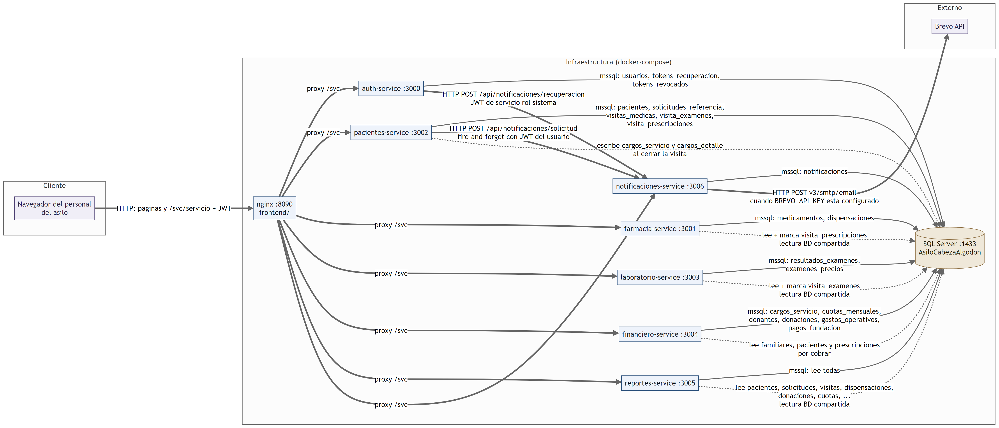
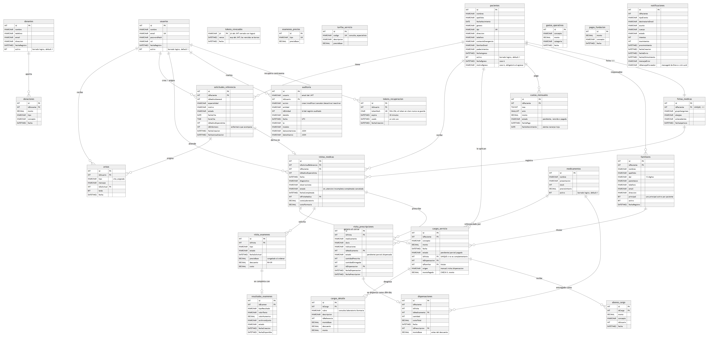

# Manual técnico — Sistema Asilo "Cabeza de Algodón"

Versión **v1.0.0** (4 de noviembre de 2026). Describe el sistema tal como
está en el código de esta versión. Fuente de verdad de reglas y roles:
[CONTEXT_SISTEMA.md](../CONTEXT_SISTEMA.md); límites conocidos:
[FALLAS_CONOCIDAS.md](FALLAS_CONOCIDAS.md).

Contenido: 1. Arquitectura · 2. Servicios y puertos · 3. Variables de
entorno · 4. Base de datos · 5. Autenticación, permisos y revocación ·
6. Reglas de negocio en el código · 7. Frontend · 8. Pruebas ·
9. Despliegue en el servidor Debian · 10. Operación.

---

## 1. Arquitectura



- **7 microservicios Node.js 20 + Express** y un **frontend** estático
  (HTML/CSS/JS sin framework) servido por **nginx**, todo en **Docker
  Compose**.
- **Una base de datos compartida**: SQL Server 2022, base
  `AsiloCabezaAlgodon`. No hay ORM: cada repositorio arma su SQL con
  parámetros (`mssql`) y mapea filas a modelos a mano.
- **El navegador solo habla con nginx** (puerto 8090): nginx sirve las
  pantallas y reenvía `/svc/<servicio>/...` al contenedor del servicio,
  agregando `X-Real-IP` y `X-Forwarded-For`.
- Comunicación entre servicios **mixta**: HTTP + JWT solo hacia
  notificaciones (pacientes → solicitud, auth → recuperación); el resto
  lee o escribe tablas de otros servicios en la base compartida (ver
  [CONTEXT_SISTEMA.md §4.1](../CONTEXT_SISTEMA.md)).

### 1.1 Las 4 capas (obligatorias en cada servicio)

```
routes/        Presentación: rutas Express, autenticar + autorizarRoles
controllers/   Lógica de negocio (entrada): lee req, llama al servicio, audita, responde
services/      Lógica de negocio: reglas RN, validaciones, cálculos (RN-09)
repositories/  Acceso a datos: SQL parametrizado, transacciones, mapeo a modelos
models/        Entidades del dominio (en español) y sus constantes de estado
middleware/    authMiddleware, autorizarRoles, confianzaProxy, manejoErrores
```

Ejemplo, cerrar una visita: `visitaMedicaRoutes.js` (`POST /:id/completar`,
solo especialista) → `VisitaMedicaController.completar` → 
`VisitaMedicaService.completar` (campos obligatorios, cálculo del cargo) →
`VisitaMedicaRepository.completarConCargo` (transacción) → modelos
`VisitaMedica` y `CargoVisita`.

Convención: dominio en español (`Paciente`, `SolicitudReferencia`,
`cantidadPrescrita`), estructura técnica en inglés (`Controller`,
`Service`, `Repository`, `routes`). `pacientes-service` agrupa tres
dominios (Paciente, Solicitud, VisitaMedica), cada uno con sus 4 capas,
porque comparten transacciones.

Cada servicio crea **sus tablas al arrancar** (`inicializarEsquema()` en
`repositories/database.js` o en el repositorio: `IF NOT EXISTS` +
`ALTER` condicionales, idempotentes) y reintenta la conexión mientras SQL
Server arranca (`DB_BOOTSTRAP_MAX_INTENTOS`, `DB_BOOTSTRAP_ESPERA_MS`).

## 2. Servicios y puertos

| Contenedor | Puerto host | Responsabilidad |
|---|---|---|
| `asilo-frontend` (nginx) | **8090** | Pantallas y proxy `/svc/<servicio>/` |
| `asilo-auth-service` | 3000 | Login, JWT, usuarios, recuperación de contraseña, logout |
| `asilo-farmacia-service` | 3001 | Inventario, dispensación contra prescripción |
| `asilo-pacientes-service` | 3002 | Pacientes, familiares, fichas, solicitudes, visitas, avisos |
| `asilo-laboratorio-service` | 3003 | Órdenes pendientes, resultados, catálogo de precios |
| `asilo-financiero-service` | 3004 | Cuentas, cargos, abonos, cuotas, alertas, donaciones, gastos |
| `asilo-reportes-service` | 3005 | 7 reportes (JSON/PDF/Excel), consulta de auditoría, vistas del Análisis |
| `asilo-notificaciones-service` | 3006 | Correo por Brevo, log y reintentos |
| `asilo-sqlserver` | 1433 | SQL Server 2022 (volumen `sqlserver-data`) |
| `asilo-db-init` | — | Crea la base `AsiloCabezaAlgodon` y termina |

Cada servicio expone `GET /health`. Los puertos 3000-3006 siguen
publicados para las pruebas (`test:e2e`, `test:carga`); el navegador no
los usa. Rutas de cada servicio: README de cada carpeta y
[CONTEXT_SISTEMA.md](../CONTEXT_SISTEMA.md#endpoints-internos-para-referencia-rápida).

**Solo por API (sin pantalla):** alta y edición de inventario
(`POST/PUT /api/farmacia/medicamentos`), log de notificaciones y su
reintento (`GET /api/notificaciones`, `POST /api/notificaciones/:id/reintentar`),
cambio de contraseña propia (`POST /api/auth/cambiar-password`).

## 3. Variables de entorno

Docker Compose lee el `.env` de la raíz (lo crea `bootstrap` copiando
`.env.example`, con valores de **desarrollo**) y pasa a cada contenedor
lo que necesita. Los `.env.example` de cada servicio sirven solo para
correrlo fuera de Docker.

**Raíz (`.env`)**

| Variable | Uso |
|---|---|
| `MSSQL_SA_PASSWORD` | Contraseña `sa` de SQL Server; los servicios la reciben como `DB_PASSWORD`. **Cambiar en producción.** |
| `JWT_SECRET` | Firma (auth) y verificación (todos) de los JWT. **Cambiar en producción.** |
| `BREVO_API_KEY`, `REMITENTE_EMAIL` | Envío real de correo. Vacía = no se envía. |
| `MODO_SIMULACION` | `true`: no llama a Brevo (ID `sim-<uuid>`). |
| `NOTIF_MAX_INTENTOS`, `NOTIF_ESPERA_BASE_SEG`, `NOTIF_ESPERA_MAX_SEG`, `NOTIF_INTERVALO_JOB_SEG` | Reintentos de correo (3; 30 s → 300 s; job cada 30 s). |
| `RECUPERACION_URL_BASE` | Origen del enlace de recuperación (por defecto `http://localhost:8090`; en el servidor, su dirección real). |

**Comunes a los servicios** (los fija `docker-compose.yml`): `PORT`,
`DB_SERVER`, `DB_PORT`, `DB_NAME`, `DB_USER`, `DB_PASSWORD`,
`DB_ENCRYPT`, `DB_TRUST_SERVER_CERTIFICATE`, `JWT_SECRET`,
`DB_BOOTSTRAP_MAX_INTENTOS` (10), `DB_BOOTSTRAP_ESPERA_MS` (3000).
`TRUST_PROXY_HOST=frontend` en auth, pacientes, farmacia y financiero
(solo se confía en el `X-Forwarded-For` del nginx).

**Por servicio** (valor por defecto entre paréntesis)

| Servicio | Variables |
|---|---|
| auth | `JWT_EXPIRES_IN` (8h; solo aquí, es quien firma), `LIMITE_INTENTOS` (5), `LIMITE_VENTANA_MIN` (15), `HASH_HILOS` (hilos de bcrypt), `RECUPERACION_MINUTOS` (30), `NOTIFICACIONES_URL`, `ADMIN_EMAIL` / `ADMIN_NOMBRE` / `ADMIN_PASSWORD` (semilla del admin; `admin@asilo.gt` / `Admin12345`) |
| pacientes | `NOTIFICACIONES_URL`, `DESCUENTO_FUNDACION` (0.20) |
| laboratorio, reportes | `DESCUENTO_FUNDACION` (0.20) |
| financiero | `DESCUENTO_FUNDACION` (0.20), `UMBRAL_ALERTA_SALDO` (1000), `UMBRAL_ALERTA_NARANJA` (la mitad), `DIAS_MORA_ROJA` (30), `CUOTAS_VENCIDAS_INTERVALO_MIN` (60) |
| notificaciones | `BREVO_API_KEY`, `BREVO_API_URL` (`https://api.brevo.com/v3/smtp/email`), `REMITENTE_EMAIL`, `REMITENTE_NOMBRE`, `MODO_SIMULACION`, `NOTIF_*` |

## 4. Base de datos



Fuente editable: [ERD.mmd](ERD.mmd). Tablas por servicio que las crea:

| Servicio | Tablas |
|---|---|
| auth | `usuarios`, `tokens_recuperacion`, `tokens_revocados` |
| pacientes | `pacientes`, `familiares`, `fichas_medicas`, `solicitudes_referencia`, `visitas_medicas`, `visita_examenes`, `visita_prescripciones`, `avisos` |
| farmacia | `medicamentos`, `dispensaciones` |
| laboratorio | `examenes_precios`, `resultados_examenes` |
| financiero | `cargos_servicio`, `cargos_detalle`, `abonos_cargo`, `tarifas_servicio`, `cuotas_mensuales`, `donantes`, `donaciones`, `gastos_operativos`, `pagos_fundacion` |
| notificaciones | `notificaciones` |
| auth, pacientes, farmacia, financiero | `auditoria` (compartida; la crea el primero que arranca) |
| los 7 | `tokens_revocados` (idempotente; la consultan todos) |

Reglas del esquema que conviene conocer:
- **Borrado lógico**: `activo BIT` en `pacientes`, `usuarios`,
  `medicamentos`, `donantes`; no hay `DELETE` físico en ellas.
- **Un cargo por visita**: índice único `UX_cargos_visita`; saldo nunca
  negativo: `CHECK CK_cargos_saldo_no_negativo`.
- **Precios congelados**: `visita_examenes.precioBase/descuento/costo` y
  `dispensaciones.montoBase` se guardan al ordenar o despachar.
- Fechas en UTC (`DATETIME2`); "hoy" para reglas de negocio se calcula en
  hora de Guatemala (UTC-6).

### 4.1 Vistas con los nombres del Análisis (solo lectura)

`internos`, `familiares_responsables`, `examenes_laboratorio`,
`despachos_farmacia`, `cargos_servicios_medicos`, `log_notificaciones`,
`log_auditoria`. Las crea reportes-service al arrancar
(`VistasAnalisisRepository`, `CREATE OR ALTER VIEW`, reintenta hasta que
existan las tablas base) y `bootstrap` con
`docker compose exec -T reportes-service npm run vistas`. Columnas y
estados equivalentes: [EQUIVALENCIAS.md](EQUIVALENCIAS.md). Si cambia una
columna de una tabla base, hay que revisar su vista.

### 4.2 Crear o regenerar la instancia

La base **no se versiona**; se crea siempre desde cero:

1. `sqlserver` arranca con el volumen `sqlserver-data`.
2. `db-init` crea `AsiloCabezaAlgodon` si no existe
   (equivalente manual: [infra/01-crear-base-datos.sql](../infra/01-crear-base-datos.sql)).
3. Cada servicio crea sus tablas y semillas mínimas (tarifa de consulta,
   catálogo de exámenes) al arrancar.
4. `bootstrap` siembra el admin (`auth-service npm run seed`), crea las
   vistas y siembra la demo (`npm run seed:demo`, idempotente).

Regenerar una base limpia con solo datos de demo (**borra todo**; solo en
un equipo de pruebas):

```powershell
docker compose down -v
.\scripts\bootstrap.ps1          # o ./scripts/bootstrap.sh
```

Verificado el 4 nov 2026: desde cero quedan 6 pacientes de demo, una
cuota vencida roja y una naranja, y las 7 vistas con filas.

Respaldo del servidor (sin borrar nada):

```bash
docker exec asilo-sqlserver /opt/mssql-tools18/bin/sqlcmd -C -S localhost -U sa -P "$MSSQL_SA_PASSWORD" \
  -Q "BACKUP DATABASE AsiloCabezaAlgodon TO DISK='/var/opt/mssql/data/asilo.bak'"
docker cp asilo-sqlserver:/var/opt/mssql/data/asilo.bak ./asilo-$(date +%F).bak
```

## 5. Autenticación, permisos y revocación

1. **Login** (`POST /api/auth/login`): contraseña con bcrypt (costo 10,
   en hilos de trabajo para no bloquear con usuarios simultáneos). Emite
   un **JWT HS256** con `sub`, `email`, `rol`, `jti` (identificador único)
   y `exp` de 8 h. Cuenta desactivada → 403 (solo con contraseña
   correcta).
2. **Límite de intentos** (`LimitadorIntentos`, en memoria): 5 fallos por
   IP real + correo en 15 minutos → 429 con `Retry-After`. Se pierde al
   reiniciar auth-service.
3. **Verificación** en cada servicio (`middleware/authMiddleware.js`,
   copia idéntica en los 7): firma con `JWT_SECRET` y `exp`; luego, si el
   token trae `jti`, consulta `tokens_revocados` (lectura por clave
   primaria; los revocados se recuerdan en memoria hasta su vencimiento).
   Revocado → 401 "Token revocado". Si la tabla no existe o la base no
   responde, **deja pasar** el token (ya verificado) y lo avisa en el log.
4. **Permisos** (`middleware/autorizarRoles.js`): cada escritura exige
   roles concretos; tabla completa en
   [CONTEXT_SISTEMA.md §3.3](../CONTEXT_SISTEMA.md). La UI oculta lo que
   el rol no puede usar (`RBAC` en `frontend/app.js`), pero el backend es
   la autoridad.
5. **Logout** (`POST /api/auth/logout`): guarda el `jti` con su
   vencimiento en `tokens_revocados` (las filas vencidas se borran al
   revocar otra). El frontend además vacía `localStorage` y
   `sessionStorage` y recarga la página. El cierre por inactividad (30
   min) hace lo mismo.
6. **Recuperación de contraseña**: `POST /api/auth/recuperar` responde
   siempre igual; guarda solo el hash SHA-256 de un token de 256 bits (30
   min, un uso). auth firma un JWT de servicio (rol `sistema`, 1 min) para
   pedir el correo a notificaciones. `POST /api/auth/restablecer` cambia
   la contraseña y consume el token en la misma transacción.
   **Envío simulado en el prototipo:** con `MODO_SIMULACION=true` el
   correo no sale; el enlace queda registrado en el servidor (cuerpo del
   correo en `notificaciones`, que la API nunca devuelve). Para la demo,
   `npm run enlace-recuperacion -- <correo>` ([scripts/enlace-recuperacion.js](../scripts/enlace-recuperacion.js))
   lo lee con `docker exec` en el stack local: toma los enlaces de los
   correos de recuperación de ese destinatario, calcula el SHA-256 de cada
   token y solo imprime el que en `tokens_recuperacion` no está usado, no
   venció y es de una cuenta activa (mismas condiciones que
   `RecuperacionService`). Sale con 0 si imprime un enlace, 1 si no hay
   vigente, 2 si no puede consultar la base. Es de solo lectura y no pasa
   por ninguna API. Con Brevo configurado el usuario recibe el enlace por
   correo y la herramienta no se usa.
7. **Regla de contraseña** (`services/reglasPassword.js`): mínimo 8
   caracteres, una letra y un número, máximo 72 bytes.
8. **Errores**: `middleware/manejoErrores.js` (copia en los 7) responde
   los 5xx con un texto genérico y deja el detalle solo en el log.

Límite conocido: desactivar una cuenta no revoca sus tokens vigentes (no
se guarda qué `jti` tiene cada usuario).

## 6. Reglas de negocio en el código

| Regla | Dónde |
|---|---|
| RN-02: una solicitud activa por paciente + especialidad | `SolicitudService.crear` + `SolicitudRepository.existeSolicitudActiva` (409 con `solicitudActiva`) |
| Paciente activo | `pacientes-service/src/services/reglasPaciente.js` (409) |
| Familiar completo | `reglasFamiliar.js` (alta) y `financiero/services/reglasCuenta.js` (cargos y cuotas) |
| Visita: diagnóstico y observaciones obligatorios; `incompleta` | `VisitaMedicaService.completar` |
| Cierre = cargo atómico (consulta + laboratorio + farmacia, RN-09) | `VisitaMedicaRepository.completarConCargo` (transacción con `UPDLOCK`, índice único de respaldo) |
| RN-06 y despacho parcial | `FarmaciaService.dispensarMedicamento` + `DispensacionRepository.registrarDespacho` (bloquea visita y prescripción en el mismo orden que el cierre; `UPDATE` condicionados; cargo complementario si la visita ya cerró) |
| Precio del examen congelado | `VisitaMedicaService` al ordenar; laboratorio y reportes calculan con el catálogo solo las órdenes antiguas sin precio |
| Saldos no negativos | `FinancieroService` (abonos) + `CHECK` en la base |
| Cuotas vencidas y alertas | `CuentaRepository.marcarVencidas` (al consultar, al arrancar y cada hora) + `services/alertasCobro.js` |
| Auditoría | `AuditoriaService` (copia en auth, pacientes, farmacia y financiero), llamada desde los controladores; nunca rompe la operación |
| Reportes y PDF | `reportes-service/src/services/ReportesService.js` (`exportarPDF`: anchos calculados, encabezado por página, totales) |

## 7. Frontend

`frontend/index.html` + `styles.css` + `app.js`, sin build. `nginx.conf`
sirve el HTML con `no-store` y CSS/JS con `no-cache` (no llevan hash en el
nombre) y hace de proxy a los servicios. Puntos de entrada de `app.js`:
`api()` (traduce 401/403 a mensajes llanos), `RBAC` (tabs y acciones por
rol), `abrirDialogo()` / `confirmar()` / `avisar()` (diálogos propios),
`cambiarTab()` (rutas `#/seccion`), `iniciarControlInactividad()`,
`etiqueta()` / `textoRol()` (nunca muestra códigos internos), vista móvil
bajo 960 px. Identidad visual:
[design-system/asilo-cabeza-de-algodon/MASTER.md](../design-system/asilo-cabeza-de-algodon/MASTER.md).

## 8. Pruebas

Requisitos: Node 20+ y `npm install` en la raíz (lo hace `bootstrap`).

| Comando | Necesita el stack | Qué prueba | Resultado v1.0.0 |
|---|---|---|---|
| `npm run test:todo` | No | Unitarias + RBAC (jest + supertest, repos simulados) | 415/415 |
| `npm run test:e2e` | Sí | Flujo completo por API, solo con registros propios | 62/62 |
| `npm run test:sqa` | Sí | 23 casos del plan del SQA | 23/23 |
| `npm run test:ui` | Sí | 9 casos del SQA desde la interfaz (Playwright headless; capturas en `docs/capturas/sqa/`) | 9/9 |
| `npm run test:hostil` | Sí | Matriz rol × escritura y validaciones | 370 sin problemas |
| `npm run test:integridad` | Sí | 20 consultas de consistencia en la base | 20/20 |
| `npm run test:carga` | Sí | `USUARIOS=50`: ninguna petición > 3 s | OK |
| `npm run test:caso11` | Sí, con el override | Brevo inalcanzable (nunca el real) | fallida → fallida_definitiva |

Las pruebas con stack son **solo para un equipo local**: crean registros
("E2E …", "SQA …", "UI …") y algunas usan `docker exec`. Para el caso 11:

```bash
docker compose -f docker-compose.yml -f scripts/override-brevo-caido.yml up -d --no-deps notificaciones-service
npm run test:caso11
docker compose up -d --no-deps notificaciones-service      # restaura la simulación
```

Detalle y mapa caso → prueba: [PLAN_PRUEBAS.md](PLAN_PRUEBAS.md).

## 9. Despliegue en el servidor Debian

Servidor del asilo: Debian con Docker Engine, accesible por Tailscale
(`100.96.172.77`) o la red local (`192.168.1.100`).

**Primera instalación**

```bash
# Requisitos: git, Node.js 20+ y Docker Engine con el plugin "compose"
# (instalación oficial: https://docs.docker.com/engine/install/debian/)
git clone https://github.com/leitorizzzz/Proyecto-AS-2.git
cd Proyecto-AS-2
cp .env.example .env
# Editar .env: MSSQL_SA_PASSWORD y JWT_SECRET nuevos (los del ejemplo son públicos),
# RECUPERACION_URL_BASE=http://100.96.172.77:8090 y, si se usa correo real,
# BREVO_API_KEY, REMITENTE_EMAIL y MODO_SIMULACION=false.
#   node -e "console.log(require('crypto').randomBytes(48).toString('hex'))"
docker compose up -d --build
docker compose exec auth-service npm run seed       # crea admin@asilo.gt
```

`bootstrap.sh` hace lo mismo **y además siembra los datos de demo**: úselo
solo si se quiere el servidor con demo. Después del primer acceso,
cambiar la contraseña del admin (`POST /api/auth/cambiar-password` o
"¿Olvidaste tu contraseña?") y crear las cuentas del personal en
**Usuarios**.

**Actualizar a una versión nueva** (flujo del equipo: cambios en Windows →
`git push` → SSH al Debian):

```bash
cd Proyecto-AS-2
git pull                          # o: git fetch --tags && git checkout v1.0.0
docker compose up -d --build      # conserva los datos (no usar -v)
```

Las tablas y columnas nuevas se crean solas al arrancar cada servicio.

## 10. Operación

- Estado: `docker compose ps` (9 contenedores `Up`, SQL Server `healthy`;
  `db-init` termina con código 0).
- Logs: `docker compose logs -f --tail 100 <servicio>`.
- Reiniciar un servicio: `docker compose restart <servicio>`.
- **Nunca** `docker compose down -v` en el servidor: borra la base.
- IP en la auditoría: en el Debian se registra la del navegador; en
  Docker Desktop todas llegan como `172.18.0.1` (ver README).
